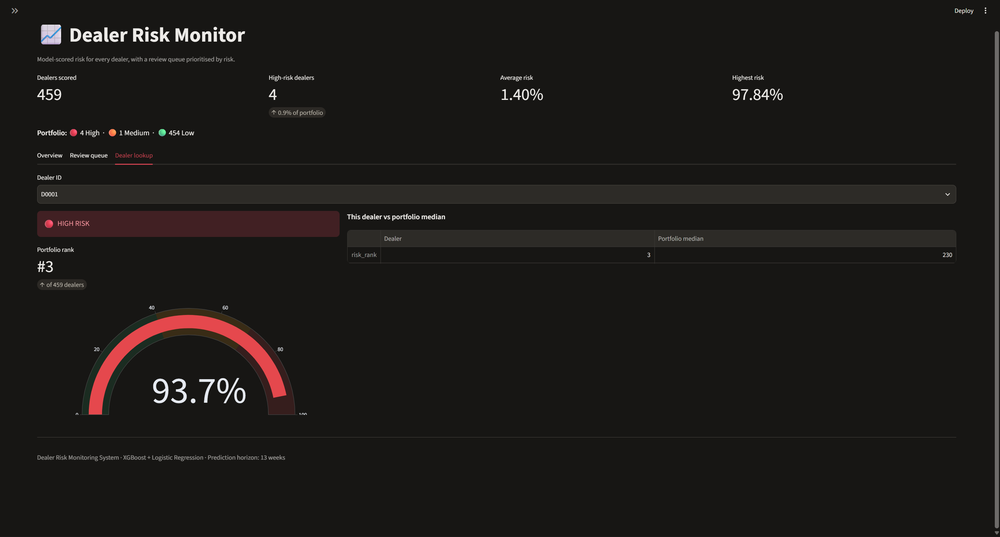

````markdown
# Dealer Risk Monitor

Dealer Risk Monitor predicts which dealers are most likely to become at risk within the next 13 weeks using machine learning (Logistic Regression and XGBoost). The model ranks dealers by predicted risk, helping reviewers focus their limited weekly review capacity on the highest-priority cases.


> **Live demo:** Coming soon. The application currently runs locally using Streamlit.

---

## Highlights

- Time-aware evaluation using a temporal train/test split
- Verified 13-week purge gap matching the prediction horizon
- XGBoost and Logistic Regression benchmarked against a rule-based baseline
- Business-focused evaluation using PR-AUC and Weekly Recall@25
- Interactive Streamlit dashboard for operational risk review
- Downloadable ranked review queue for operational teams

---

## Business Problem

The goal of Dealer Risk Monitor is to identify dealers that are likely to become at risk within the next 13 weeks so that business teams can intervene before payment issues become more severe.

Each week, every dealer receives a predicted risk score. Because reviewers have capacity to investigate only a limited number of dealers, the model ranks dealers by predicted risk and prioritises the top 25 dealers for manual review.

The project is evaluated using ranking-based metrics that reflect this operational workflow rather than overall classification accuracy.

---

## Dataset

The project uses anonymised dealer-level data for model development. The raw dataset is not included in this repository.

Only the source code, trained artifacts, and demo predictions required to reproduce the dashboard are included.

| Item | Value |
|------|------:|
| Test period | 46 weeks |
| Dealers per week | ~464 |
| At-risk dealers per week | ~3.6 (0.77%) |
| Prediction horizon | 13 weeks |

The dataset is highly imbalanced (0.77% positives), making PR-AUC and Weekly Recall@25 more informative than accuracy.

A random Top-25 review queue would identify only about 5% of at-risk dealers.

---

## Feature Engineering

Features are engineered from historical dealer behaviour using rolling windows and trend-based statistics. Every feature at week **t** is computed only from information available at week **t**.

Feature groups include:

- **Payment behaviour:** average payment delay, payment delay trends and volatility, collection ratios over 4-, 8-, and 12-week windows.
- **Ageing & delinquency:** days past due, overdue balance ratios, unpaid invoice counts, and outstanding balances.
- **Business activity:** order trends, invoice volumes, GST turnover changes, and outstanding balance relative to business activity.
- **External signals:** credit bureau scores, recent score changes, GST registration status, and active court cases.
- **Peer context:** dealer performance relative to the portfolio median, including payment delays and credit scores.
- **Dealer profile:** dealer size, credit terms, tenure, and geographic region.
- **Calendar features:** cyclical month encodings to capture seasonality.

All engineered features use only information available at the prediction week to avoid future information leakage.

---

## Models

- **Rule-based baseline:** ranks dealers using a manually designed risk score based on key payment and delinquency indicators.
- Logistic Regression
- XGBoost

---

## Evaluation

The models are evaluated using a strictly time-based split.

### Temporal Split

Training uses earlier weeks while testing uses later weeks. Random train/test splits are never used.

### Purge Gap

The temporal train/test split includes a **verified 13-week gap** between the final training week (**83**) and the first test week (**97**), matching the 13-week prediction horizon.

The verification can be reproduced by running:

```bash
python check_split.py
```

The script verifies the temporal split boundary only. Feature engineering should also be reviewed separately to ensure every feature at week **t** uses only information available at week **t**.

### Metrics

The primary evaluation metrics are:

- **PR-AUC**, appropriate for highly imbalanced datasets.
- **Weekly Recall@25**, reflecting the operational review capacity of 25 dealers per week.

### Statistical Comparison

A paired bootstrap comparison between models has not yet been performed and is planned as future work.

---

## Results

| Model | PR-AUC | ROC-AUC | Weekly Recall@25 |
|------|-------:|--------:|-----------------:|
| Rule-based baseline | 0.824 | Not yet reported | Not yet reported |
| Logistic Regression | 0.844 | Not yet reported | Not yet reported |
| **XGBoost** | **0.849** | Not yet reported | Not yet reported |

XGBoost achieved the highest PR-AUC (0.849), followed closely by Logistic Regression (0.844) and the rule-based baseline (0.824). While the performance improvement is modest, the machine learning models provide better prioritisation of the limited weekly review queue, enabling reviewers to focus on the dealers most likely to become at risk.

---

## Dashboard

| Overview | Review Queue | Dealer Lookup |
|----------|--------------|---------------|
|  |  |  |

### Features

- Adjustable High and Medium risk thresholds
- Automatic risk tiers
- Portfolio ranking
- Ranked review queue
- CSV export
- Dealer lookup
- Dealer vs portfolio median comparison
- Interactive risk gauge

The dashboard scores one prediction per dealer and presents a prioritised review queue for operational users.

The committed demo predictions allow the dashboard to be explored without requiring access to the original training dataset.

---

## How to Run

### Dashboard Only (uses committed demo predictions)

```bash
python -m venv .venv

# Linux / macOS
source .venv/bin/activate

# Windows
.venv\Scripts\activate

pip install -r requirements.txt

streamlit run dashboard/app.py
```

### Full Training Pipeline

Place the raw source data under the `data/` directory before running the training pipeline. The raw dataset is not included in this repository.

```bash
pip install -r requirements-train.txt

python models/train_models.py

python inference/predict.py
```

---

## Tech Stack

- Python
- pandas
- NumPy
- scikit-learn
- XGBoost
- Streamlit
- Plotly

---

## Project Structure

```text
dealer-risk-monitor/
│
├── dashboard/
│   └── app.py
├── models/
├── inference/
├── features/
├── notebooks/
├── artifacts/
│   ├── risk_predictions.csv
│   └── ranking_eval.png
├── images/
│   ├── overview.png
│   ├── queue.png
│   └── lookup.png
├── data/
├── check_split.py
├── requirements.txt
├── requirements-train.txt
└── README.md
```

---

## Limitations

- The dashboard explains **who** is high risk but not **why**.
- Predictions are generated offline rather than through a live inference service.
- Labels look 13 weeks ahead, so consecutive weekly observations for the same dealer are not independent.
- The held-out test period contains relatively few positive events because dealer risk is rare, making performance estimates naturally more variable.
- The rule-based baseline performs strongly, so the machine learning models provide only a modest improvement while offering better prioritisation of high-risk dealers.

---

## Future Work

- SHAP explanations for individual dealer predictions
- Automated model retraining
- Real-time inference pipeline
- Model monitoring and drift detection
- CI/CD deployment pipeline

---

## License

This project is released under the MIT License.
````