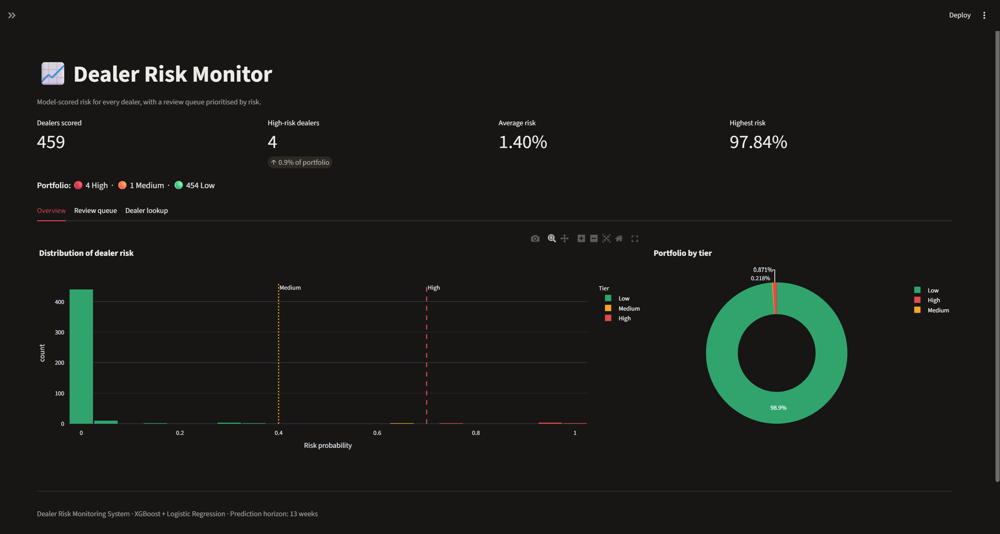
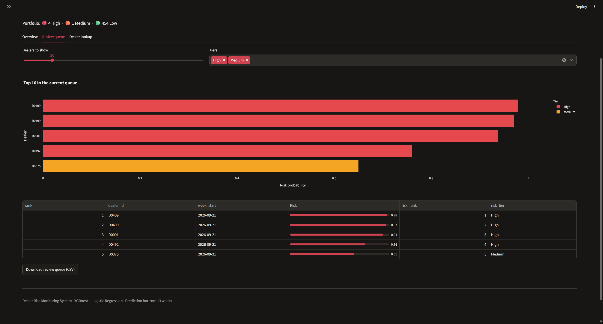
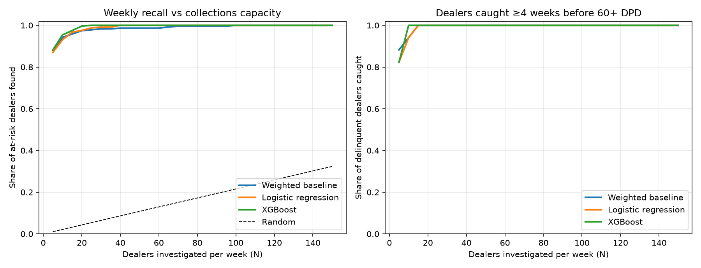

# Dealer Risk Monitor


> A machine learning application for prioritising high-risk dealers using temporal modelling and an interactive Streamlit dashboard.

Dealer Risk Monitor predicts which dealers are most likely to become at risk within the next **13 weeks**. The project benchmarks a rule-based baseline, Logistic Regression and XGBoost to rank dealers by predicted risk, enabling reviewers to focus their limited weekly review capacity on the highest-priority cases.

> **Live demo:** Not yet deployed. The application currently runs locally using Streamlit (see **How to Run** below).

---

## Dashboard

| Overview | Review Queue | Dealer Lookup |
|----------|--------------|---------------|
|  |  |  |

The dashboard enables operational teams to review weekly risk predictions, inspect individual dealers, adjust risk thresholds and export prioritised review queues.

---

## Highlights

- Time-aware evaluation with a strictly temporal train/test split
- 13-week purge gap between train and test, matching the prediction horizon
- Three approaches benchmarked: rule-based baseline, Logistic Regression, XGBoost
- Business-focused evaluation using PR-AUC and Weekly Recall@25
- Interactive Streamlit dashboard for operational risk review
- Downloadable ranked review queue

---

## Key Results

Evaluated on a held-out period of 46 weeks:

| Model | PR-AUC |
|-------|-------:|
| Rule-based baseline | 0.824 |
| Logistic Regression | 0.844 |
| **XGBoost** | **0.849** |

- Predicts dealer risk **13 weeks in advance**
- The top 25 dealers each week form the manual review queue
- Both ML models improve on the rule-based baseline; the gap between XGBoost and Logistic Regression is small (see the **Limitations** section below)

---

## Business Problem

Operational teams can only review a limited number of dealers each week. The goal is to identify dealers likely to become at risk within the next **13 weeks**, so reviewers can intervene before payment issues become more severe.

Each week, every dealer receives a predicted risk score. Dealers are ranked by score and the highest-risk ones are prioritised for review.

Because the task is prioritisation rather than binary classification, models are evaluated with ranking metrics that mirror the real workflow.

---

## Dataset

The project uses anonymised dealer-level data. The raw dataset is proprietary and **not included** in this repository.

The repository includes trained model artifacts and sample prediction files required to reproduce the dashboard experience without exposing proprietary data.

| Item | Value |
|------|------:|
| Test period | 46 weeks |
| Dealers per week | ~464 |
| At-risk dealers per week | ~3.6 (0.77%) |
| Prediction horizon | 13 weeks |

The data is highly imbalanced (0.77% positives), so **PR-AUC** and **Weekly Recall@25** are more informative than accuracy. A random Top-25 queue would capture only about **5%** of at-risk dealers each week (25 / 464 ≈ 5.4%).

---

## Feature Engineering

Features are built from historical dealer behaviour using rolling windows and trend statistics. Every feature at week **t** is computed only from information available at week **t**.

- **Payment behaviour**: average payment delay, delay trends, delay volatility and collection ratios over rolling 4-, 8- and 12-week windows.
- **Ageing & delinquency**: days past due, overdue balance ratios, unpaid invoice counts and outstanding balances.
- **Business activity**: order trends, invoice volumes, GST turnover changes and outstanding balance relative to business activity.
- **External signals**: credit bureau scores, recent score changes, GST registration status and active court cases.
- **Peer context**: dealer performance relative to the portfolio median, including payment delays and credit scores.
- **Dealer profile**: dealer size, credit terms, tenure and region.
- **Calendar**: cyclical month encodings for seasonality.

---

## Models

- **Rule-based baseline**: a heuristic benchmark for ranking dealers
- **Logistic Regression**: a linear, interpretable machine learning model
- **XGBoost**: gradient-boosted decision trees

---

## Evaluation

### Temporal Split

Training uses earlier weeks and testing uses later weeks. Random splits are never used.

### Purge Gap

The final training week is **83** and the first test week is **97**, so weeks 84-96 (exactly **13 weeks**) are excluded. This matches the prediction horizon: a label for a training week near the boundary looks forward up to 13 weeks, and the gap ensures that window does not overlap the test period.

Verify the boundary with:

```bash
python check_split.py
```

The script checks the split boundaries only. Leakage prevention in the features themselves comes from the feature-engineering design described above.

### Metrics

- **PR-AUC**: suited to highly imbalanced data.
- **Weekly Recall@25**: the share of that week's at-risk dealers captured in the top 25, reflecting real review capacity.

---

## Results

| Model | PR-AUC |
|-------|-------:|
| Rule-based baseline | 0.824 |
| Logistic Regression | 0.844 |
| **XGBoost** | **0.849** |

The rule-based baseline already performs strongly, indicating that payment behaviour and delinquency features are highly informative predictors of future dealer risk. The machine learning models add modest improvements in ranking quality on top of this baseline.

### Performance Comparison



---

## Dashboard Features

- Adjustable High and Medium risk thresholds with automatic risk tiers
- Portfolio ranking and a ranked weekly review queue
- CSV export of the queue
- Dealer lookup with dealer-vs-portfolio-median comparison
- Interactive risk gauge

The dashboard shows one prediction per dealer.

---

## Pipeline

```text
Raw Dealer Data
        │
        ▼
Feature Engineering
        │
        ▼
Temporal Split
(13-week Purge Gap)
        │
        ▼
Model Training
(Logistic Regression / XGBoost)
        │
        ▼
Risk Scoring
        │
        ▼
Ranked Review Queue
        │
        ▼
Streamlit Dashboard
```

---

## How to Run

### Dashboard (no raw data needed)

```bash
python -m venv .venv

# Linux / macOS
source .venv/bin/activate

# Windows
.venv\Scripts\activate

pip install -r requirements.txt
streamlit run dashboard/app.py
```

### Training Pipeline (requires the raw dataset)

Place the raw dataset in `data/`, then run:

```bash
pip install -r requirements-train.txt
python models/train_models.py
python inference/predict.py
```

---

## Tech Stack

- Python
- Pandas
- NumPy
- Scikit-learn
- XGBoost
- Streamlit
- Plotly
- Git

---

## Project Structure

```text
dealer-risk-monitor/
├── dashboard/          # Streamlit application
├── features/           # Feature engineering
├── inference/          # Prediction pipeline
├── models/             # Model training
├── notebooks/          # Exploratory analysis
├── artifacts/          # Saved models and predictions
├── images/             # README screenshots
├── data/               # Raw data (not included)
├── check_split.py
├── requirements.txt
├── requirements-train.txt
└── README.md
```

---

## Limitations

- The dashboard shows **who** is high risk but not **why**.
- Predictions are generated offline, not through a live inference service.
- Labels look 13 weeks ahead, so consecutive weekly rows for the same dealer are highly correlated and not independent.
- Only about 3.6 positives occur per week (~165 over the test period), so metric estimates are noisy. No confidence intervals have been computed, and small differences between models, such as XGBoost vs Logistic Regression, should not be over-interpreted.
- Delinquency features may be closely related to the label, which likely explains why the rule-based baseline already scores high.
- Results come from a single temporal split on one proprietary dataset; generalisation to other periods or portfolios is untested.

---

## Future Work

- Confidence intervals for metrics (e.g. bootstrap resampling by week)
- SHAP explanations for individual dealer predictions
- Automated retraining, model monitoring and drift detection
- Real-time inference service
- CI/CD pipeline
- Streamlit Cloud deployment

---

## License

Released under the MIT License.